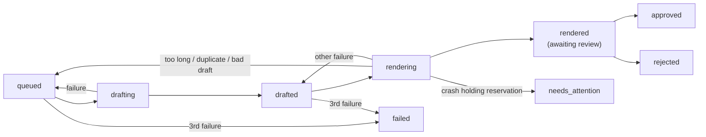

# Production queue (orchestrator)

`orchestrator.py` turns topics into rendered Shorts and stops at **human review**.
It never uploads. State lives in `storage/usage.sqlite3` (tables `queue_jobs`,
`queue_events`) next to the render/story/source claims described in DATABASE.md.



## Commands

```powershell
$env:PYTHONUTF8 = '1'
.venv\Scripts\python.exe orchestrator.py enqueue --topic "A night guard finds his own name on tomorrow's visitor log"
.venv\Scripts\python.exe orchestrator.py enqueue --topics-file topics.txt --provider fish
.venv\Scripts\python.exe orchestrator.py status [--stage rendered]
.venv\Scripts\python.exe orchestrator.py show <id-prefix>
.venv\Scripts\python.exe orchestrator.py approve <id-prefix> --note "good hook"
.venv\Scripts\python.exe orchestrator.py reject <id-prefix> --note "weak ending"
.venv\Scripts\python.exe orchestrator.py schedule <id-prefix> [--publish-at <UTC-ISO>] [--dry-run]
.venv\Scripts\python.exe orchestrator.py schedule-approved [--dry-run]
.venv\Scripts\python.exe orchestrator.py retry <id-prefix>
.venv\Scripts\python.exe orchestrator.py replenish [--target 3] [--with-agy] [--query <query>]
powershell -NoProfile -ExecutionPolicy Bypass -File .\run_orchestrator_windows.ps1 -MaxJobs 1
```

Job ids accept any unique prefix of 4+ characters, which keeps Telegram/Hermes
commands short. `--provider` defaults to `fish`; `--gameplay` and
`--background-file` are passed through to `pipeline.py`.

## Behaviour

- **Background Footage Replenishment (`replenish`):**
  Ensures a minimum pool of unreserved CC0/CC-BY clips in `storage/backgrounds/`.
  Can be run deterministically or with `--with-agy` to summon Antigravity CLI's
  `gemini-3.8-flash-medium` model non-interactively to discover fresh aesthetic
  queries fitting the vertical mystery/horror atmosphere.
- **YouTube Automated Scheduling (`schedule` / `schedule-approved`):**
  Uploads approved videos to YouTube via the Data API v3 and schedules them for release.
  Calculates next available future slots (09:00, 14:00, 19:00 local time) converted
  to UTC ISO 8601 with zero-collision sequential roll-over. Sets `privacyStatus='private'`
  until `publishAt` triggers. Stores the returned `youtube_id` in SQLite so duplicate
  uploads are strictly prevented. Supports `--dry-run` to test without sending API calls.
- **One runner at a time.** An OS file lock (`storage/orchestrator.lock`) makes a
  second concurrent `run` exit immediately with code 0. The OS releases the lock
  if the runner is killed (verified with a hard kill on Windows).
- **Each `run` advances at most `--max-jobs` jobs** (default 1), oldest first,
  each as far as review. Drafting uses Hermes (`draft_story.py`); rendering uses
  `pipeline.run_pipeline` with the job's provider. Both consume real quota.
- **Bounded retries.** A job gets 3 failures in total across drafting and
  rendering, then becomes `failed`. Retries happen on later runs, never in a tight loop.
  - Hermes errors or out-of-range drafts: draft again.
  - `NarrationTooLong` (pre-TTS estimate or measured), an unreadable draft, or a
    story that duplicates an existing render: discard the draft and redraft.
    The duplicate check runs before any TTS call.
  - Any other render failure (network, footage pool, FFmpeg): keep the draft and
    retry the render.
- **Crash recovery** runs at the start of every `run`, under the lock:
  - interrupted `drafting` → `queued`;
  - interrupted `rendering` with no held reservation → `drafted` (retry);
  - render that actually finished (usage job `rendered`, file present) → `rendered`;
  - render still holding a reservation → `needs_attention`, with the exact
    `usage_store.py --release-reservation` command to run after inspection.
    `retry` refuses until that reservation is released.
- **Exit codes** for `run`: 0 normal (including "busy"/"nothing to do"), 1 if a
  job ended `failed`/`needs_attention`, 2 for invalid commands.
- `approved` is a terminal hand-off. There is no uploader integration yet.

## Not done yet

- No Task Scheduler entry is installed. `run_orchestrator_windows.ps1` logs to
  `storage/logs/` and is ready to be scheduled once unattended runs are approved.
- Hermes must be reachable non-interactively (`HERMES_HOME`, subscription login)
  for scheduled drafting; this has only been verified in interactive sessions.
- Upload stage, idempotent YouTube `video_id` storage and timezone-correct
  `publishAt` scheduling (see HANDOFF.md defects 6–8).
- Topic sourcing is manual (`enqueue`); no automatic premise generation.
